# Orbit

A desktop assistant for Windows 11 that you talk to. Say "hey orbit, open Spotify and play lofi on the Echo", "volume 30",
"close Notepad" or "open my GitHub" and it does it, using whichever way is most reliable (the Spotify API, Windows itself, or
your browser). It is also a friend you can chat with. It lives in the system tray, and a small orb floats up over your work
only while Orbit is doing something.

<p align="center">
  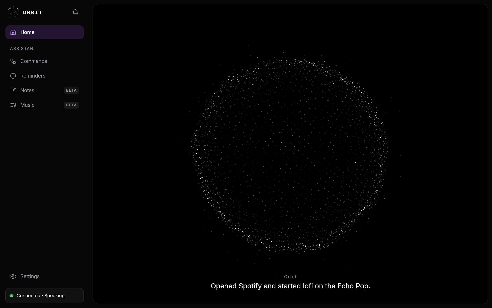
</p>

- **Local by default, cloud when you add keys.** With no keys, the language model (Qwen2.5 7B via Ollama), speech-to-text
  (Whisper) and the voice (Piper) all run on this PC and nothing leaves it. Add a Groq and/or Sarvam key and each part switches
  to the cloud on its own, for much lower latency.
- **Safe by design.** Risky actions (closing a window, quitting an app, buying, sending, deleting) ask you yes or no first, by
  voice, by clicking, or with a key chord. Everything Orbit does is printed first and logged with secrets redacted.
- **You can watch it work.** Orbit's own pointer glides to what it is about to click, presses it with a ripple, carries a window
  across monitors by its title bar, and a small "working" pill shows while a job runs ([details](#seeing-what-orbit-does)).
- **Tested.** 1719 Python tests and 318 Rust tests pass.

## Contents

[What it can do](#what-it-can-do) · [Setup](#setup-windows-11) · [How it works](#how-it-works) · [Seeing what Orbit does](#seeing-what-orbit-does) ·
[The desktop app](#the-desktop-app) · [Reminders, notes and music](#reminders-notes-tasks-and-music) · [Voice](#voice) · [Spotify](#spotify-api-layer) ·
[Browser](#browser-layer) · [Friend mode](#friend-mode) ·
[Ask about your screen](#ask-about-your-screen) · [Privacy](#privacy) · [Known limits](#known-limits-honest-list)

## What it can do

| Layer | What Orbit can do |
|---|---|
| **API** (best, tried first) | Spotify: play a song, artist, album, playlist or your liked songs; transfer playback to a speaker or phone; per-device volume; play, pause, next, previous; now playing. |
| **OS** (Windows itself) | Open and close apps ("quit" ends every process of an app), list, focus, move and arrange windows across monitors, volume and mute, media keys, the time and date, click UI controls in any app by name or by picture ("the gear icon"; UI Automation, with OCR as a fallback), type into the box that has the cursor, scroll a window, and read what a window shows. |
| **Browser** | Search Google, scroll the results, click a link by its words, by its picture ("the search icon") or by number ("the second result"), click a text box, type and press Enter, navigation (back, forward, reload, home), tabs (list, switch, close), YouTube play and fullscreen. |
| **Chat** | Talk about your day, ask a doubt, get encouragement or a roast. Anything that is not a PC command is chat. |
| **Your own commands** | Make a phrase that runs a list of steps: open apps, websites and folders, press keys, type text, wait. |
| **Your own things** | Reminders and timers ("remind me to call mom at 5"), notes and a task list ("note down the wifi is on the router", "add milk to my tasks"), and your saved Spotify playlists ("play my gym playlist"): said in plain words, made in the window, answered with no language model. |

Several requests in one sentence work ("open Spotify, then play my favourite music on the speaker"). Simple commands are handled
by fast rules with no model call.

## Setup (Windows 11)

**Orbit (Python 3.12):**

1. Install [Ollama](https://ollama.com) and start it, then `ollama pull qwen2.5:7b` (about 4.7 GB). Install Brave (or Google
   Chrome; `--browser chrome`).
2. In this folder: `python -m venv .venv`, then `.venv\Scripts\activate`.
3. `pip install -e ".[dev,voice,ipc]"` (`dev` for the tests, `voice` for the microphone and speech, `ipc` for the desktop app).
4. Text mode: `python -m orbit` (add `--no-llm` for rules only; `python -m orbit "volume 30"` runs one request and exits;
   `--fake-tools` adds the Step 1 test tools).
5. Voice (optional), download the models once; this is the only thing that touches the network for voice, and only when you run it:
   ```
   python -m orbit.voice.fetch_models whisper small.en tiny.en
   python -m orbit.voice.fetch_models piper en_US-amy-medium
   python -m orbit.voice.fetch_models wakeword hey_mycroft
   python -m orbit --voice
   ```
6. Spotify (optional): create an app at developer.spotify.com (redirect URI `http://127.0.0.1:8888/callback`, Web API), add your
   account under User Management, then `setx SPOTIFY_CLIENT_ID "<client id>"`, open a new terminal and run
   `python -m orbit auth spotify` once.
7. Cloud (optional): copy `.env.example` to `.env` and add `GROQ_API_KEY` / `SARVAM_API_KEY` (see [Cloud mode](#cloud-mode-groq--sarvam-ai)).

**The desktop app (Rust, optional)**, in `ui/`: install [Rust](https://rustup.rs) (the toolchain is pinned to 1.99.1 and
installs itself), then `cargo run --release -- --spawn`. It starts Orbit for you and puts it in the tray.

**Tests:** `pytest` (Python) and, from `ui/`, `cargo test` (Rust; the link tests use this project's `.venv`).

## How it works

```
text or voice -> fast rules (no model) --match--> tool call
              -> LLM (tool calling)  ----------->     |
                                               validate (pydantic)
                                               safety gate (risky = ask you first)
                                               router: api -> os -> browser (best layer first)
                                               verify the effect; retry once; fall back to the next layer
                                               result -> back to the model / final reply
```

- Everything the agent does is printed first and logged to `logs/orbit.log` (secrets redacted).
- Ctrl+C stops a running request. Step cap: 8 model round-trips. It stops after 3 failed tool calls in a row.
- An action is only reported as done when Orbit checked the effect (a window closed, a track changed, a page changed).
- The name lives in `src/orbit/config.py` (`APP_NAME`), with the limits and model names.

## Seeing what Orbit does

Orbit draws its own animations over your screen, so you can follow what it is doing instead of watching things happen by themselves:

<p align="center">
  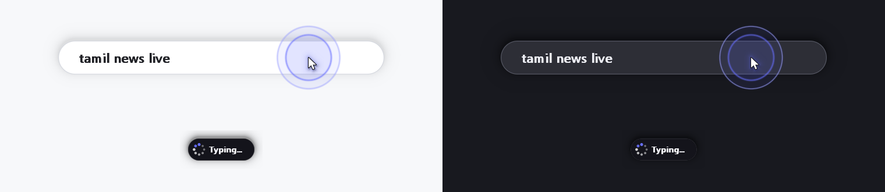
</p>

- **Orbit's pointer** glides along a curved path to the thing it is about to click (arriving from where your own mouse is), presses
  it, and leaves a ripple. It is Orbit's own pointer: your real mouse is not taken over (it only moves briefly to turn a scroll
  wheel, then goes back).
- **Moving a window to another monitor:** the pointer grabs the window's title bar and the window slides across, carried by it.
  Maximize, minimize, restore and close press the window's own buttons the same way.
- **The "working" pill** (a spinner and a few words: "Searching Google...", "Typing...", "Scrolling...") sits at the bottom of the
  window Orbit is working in, and only appears if the job takes more than a moment.
- **Safe by design:** the animations are click-through, never take the focus, and are excluded from screen capture (Windows 10
  2004 or newer), so they can never confuse Orbit's own OCR or its "did the page change?" checks. If they cannot start, or
  anything goes wrong, Orbit carries on without them.
- **Switch off or tune:** `--no-visuals`, or `ORBIT_VISUALS=0`; `ORBIT_VISUALS_SPEED=2` for twice as fast. See them without
  clicking anything: `python -m orbit.visual.demo`.

## The desktop app

Orbit's face is `orbit-ui` (in `ui/`, see [ui/README.md](ui/README.md) for everything): a particle sphere drawn on the GPU, and a
window with a sidebar of pages. It lives in the tray. When Orbit does something, a small orb floats up at the bottom right, above
the taskbar, showing what it is doing and how loud the voice is; a few seconds after things go quiet it fades away. The orb never
takes focus and clicks pass through it, so it never gets in your way.

The window's sidebar has **Home** (the big sphere, and what was last said), **Commands**, **Reminders**, **Notes** (with tasks),
**Music** and, at the bottom, **Settings**. The bell at the top shows how many reminders have gone off since you last looked, and
the box at the bottom says whether Orbit is connected and what it is doing.

<table>
  <tr>
    <td align="center">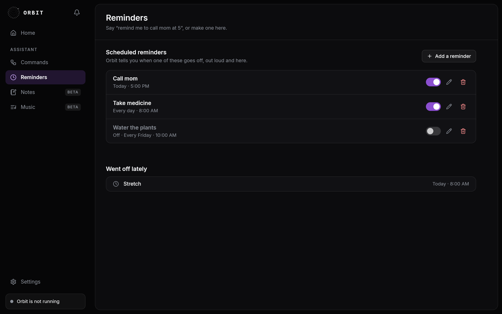<br><sub><b>Reminders</b></sub></td>
    <td align="center">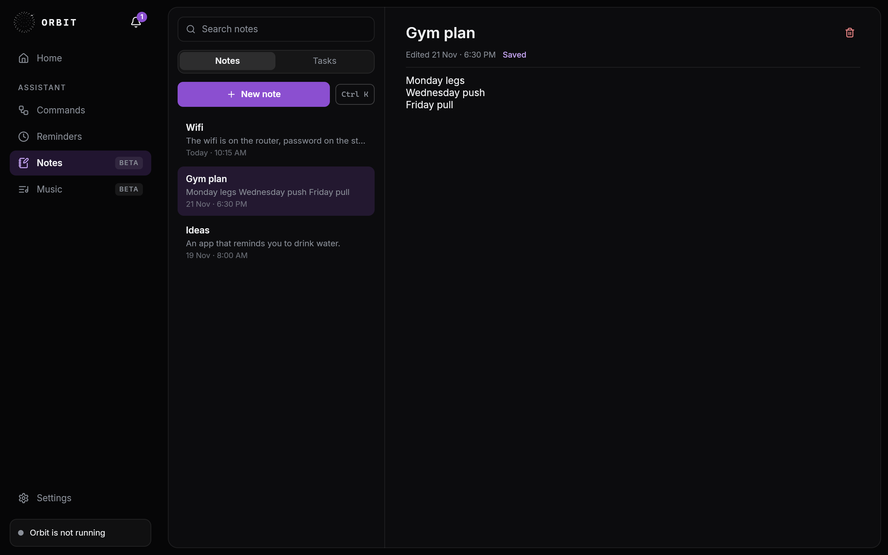<br><sub><b>Notes</b> and <b>tasks</b></sub></td>
  </tr>
  <tr>
    <td align="center">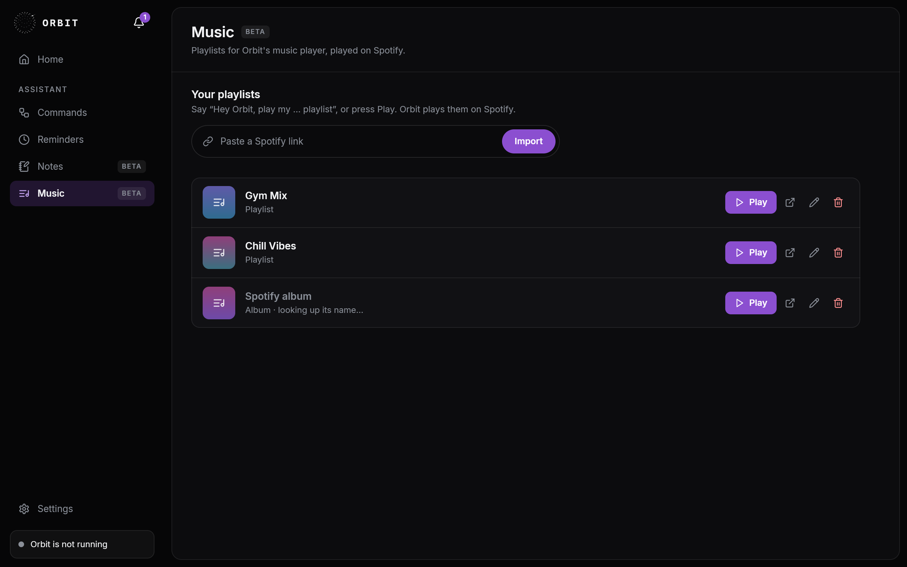<br><sub><b>Music</b>: your Spotify playlists</sub></td>
    <td align="center">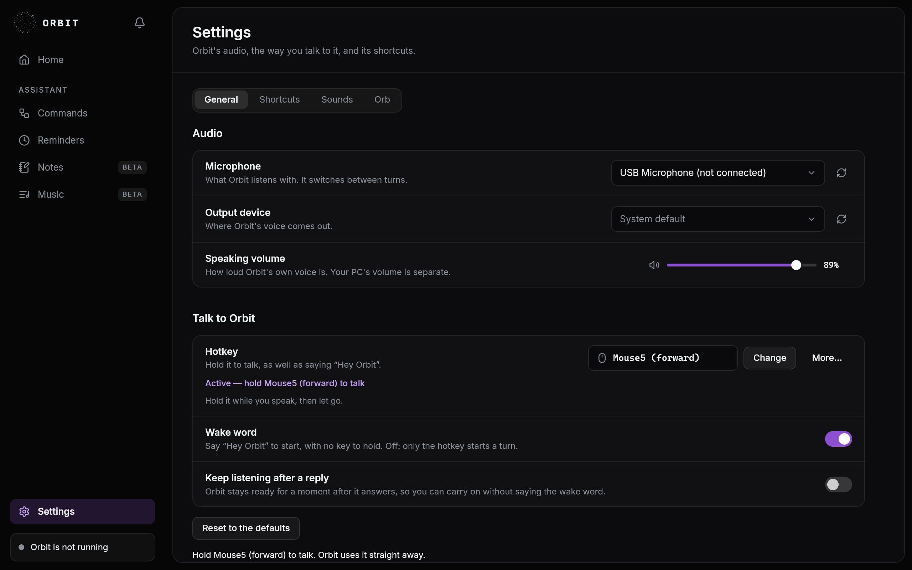<br><sub><b>Settings</b>: audio and how you talk</sub></td>
  </tr>
</table>

```
cd ui
cargo run --release -- --spawn        # start Orbit (microphone, wake word, model) and keep it in the tray
cargo run --release -- --spawn-demo   # a scripted turn with a yes/no question, no microphone needed
orbit-ui --autostart on               # start with Windows (off to undo; status to look). Never set unless you ask.
```

Every state has its own motion: idle, wake, listening (the surface follows your voice), transcribing, thinking, confirming
(an amber pulse), speaking (waves with the voice level), follow-up, success, error and muted.

<table>
  <tr>
    <td align="center">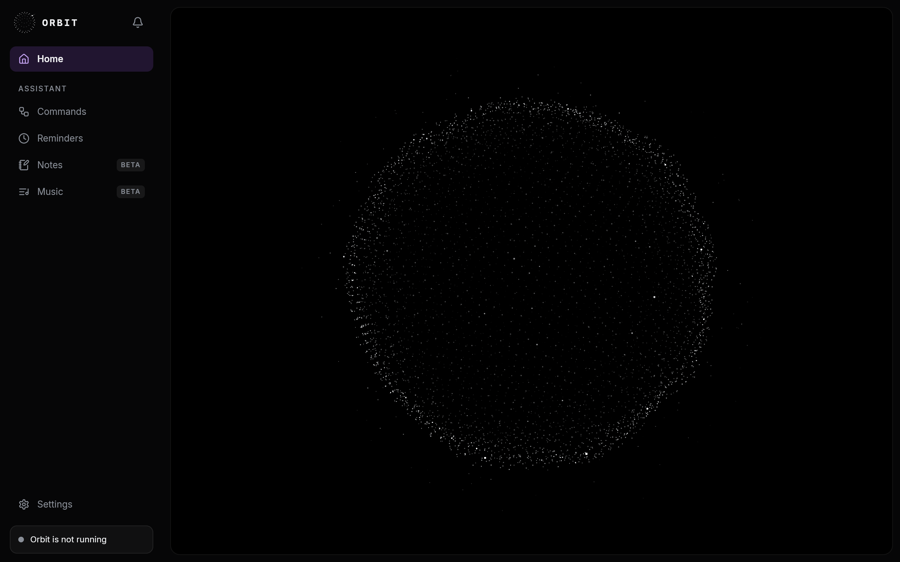<br><sub><b>Listening</b>: the surface follows your voice</sub></td>
    <td align="center">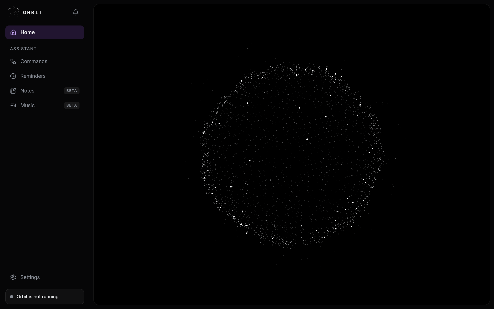<br><sub><b>Thinking</b>: tilted spin, travelling sparks</sub></td>
  </tr>
</table>

### Risky actions ask first

When Orbit needs a yes or no, the question appears above the sphere. Answer by clicking, by voice, or with **Ctrl+Alt+Y** /
**Ctrl+Alt+N** (those two chords are only held while a question is open, so they never take the keys from another program the
rest of the time). Esc says no.

<p align="center">
  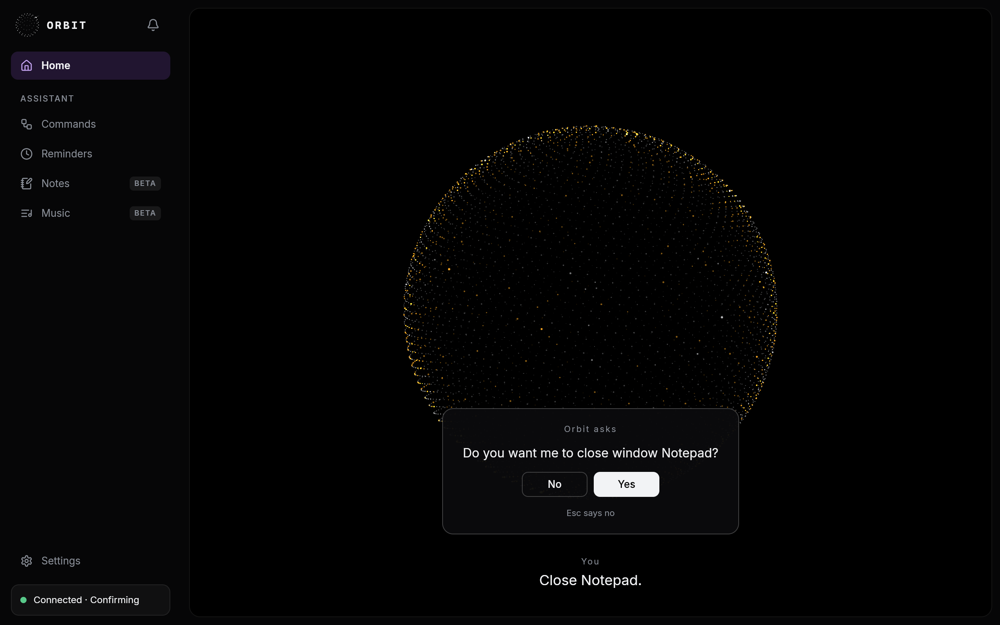
</p>

### Settings

Every change is saved the moment you make it, to `settings.json` in the project folder (git-ignored; `ORBIT_SETTINGS` moves it).
A hand-edited file Orbit cannot fully read does not stop anything: the bad entry is left out, the page lists what, and the first
save keeps the old file as `settings.json.bak`. The page has four tabs: General, Shortcuts, Sounds and Orb. (Your own commands
have a page of their own in the sidebar.)

**General.** *Audio:* the microphone and the output device (pick from the list, or the Windows default; the refresh button looks
again), and the speaking volume, how loud Orbit's own voice is (0 to 100; your PC's volume is separate). Orbit follows each of
these between turns, with no restart. *Talk to Orbit:* the hotkey you hold to speak (**Change**, then press a key or click a mouse
button; **More...** picks from a list), whether the **wake word** "Hey Orbit" is listened for, and whether Orbit **keeps listening
after a reply** so you can carry on without it. A choice made on the command line (`--mic`, `--no-wake`, `--no-follow-up`) or in
the environment (`ORBIT_MIC`, `ORBIT_SPEAKER`) wins over the page.

<p align="center">
  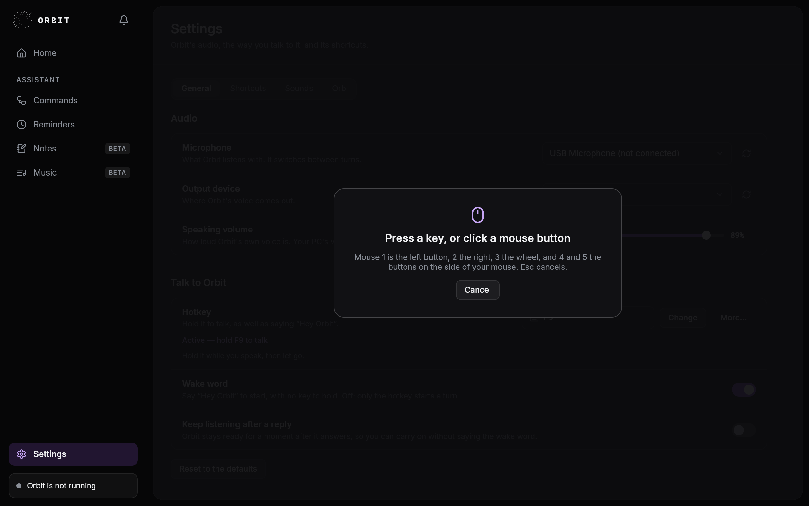
</p>

**The hold-to-talk key can be a mouse button.** While it is being recorded, a click of any mouse button on the page is taken:
Mouse 1 (left), Mouse 2 (right), Mouse 3 (the wheel), and Mouse 4 (back) and Mouse 5 (forward) on the side of the mouse; or a key
(Right Ctrl, an F key, Pause...). A key that types something (a letter, Enter, an arrow) is refused with the reason, since holding
it to talk would type it into every app. A mouse button is also what you click with, so Orbit only starts listening once it has
been held for about a quarter of a second: an ordinary click does nothing, and the button still clicks as it always does.

**Shortcuts.** Click a chord and press the new keys (Esc cancels). The orb, yes and no chords take effect at once; one Windows
will not give Orbit is refused with a reason and nothing changes.

<p align="center">
  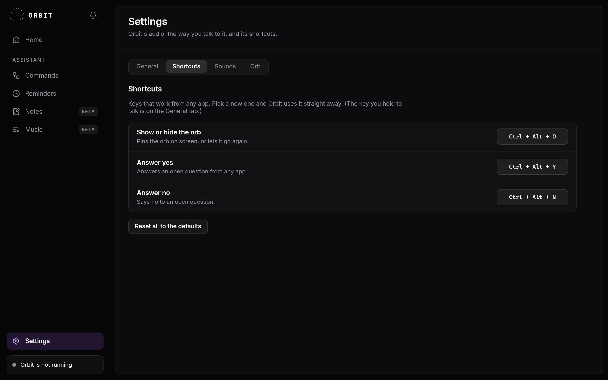
</p>

**Commands** (its own page). Say a phrase and Orbit runs a list of steps in order, without asking the language model. Say it exactly
(filler like "please" and a leading "run" are fine). A command that presses keys or types asks one yes or no first, listing
everything it will do. Steps that open a folder only open it: nothing is ever run, and the language model never sees these
commands and cannot press keys or type. Switch a command off without deleting it.

<table>
  <tr>
    <td align="center">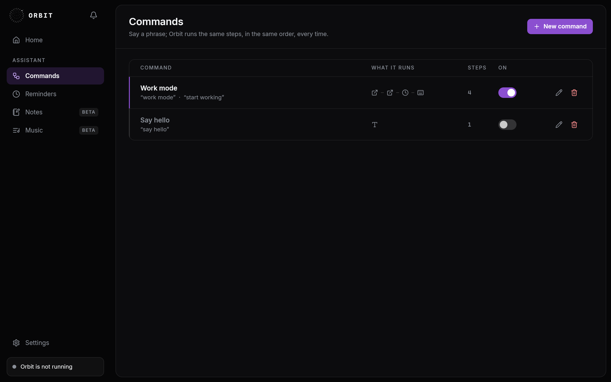<br><sub>Your commands</sub></td>
    <td align="center">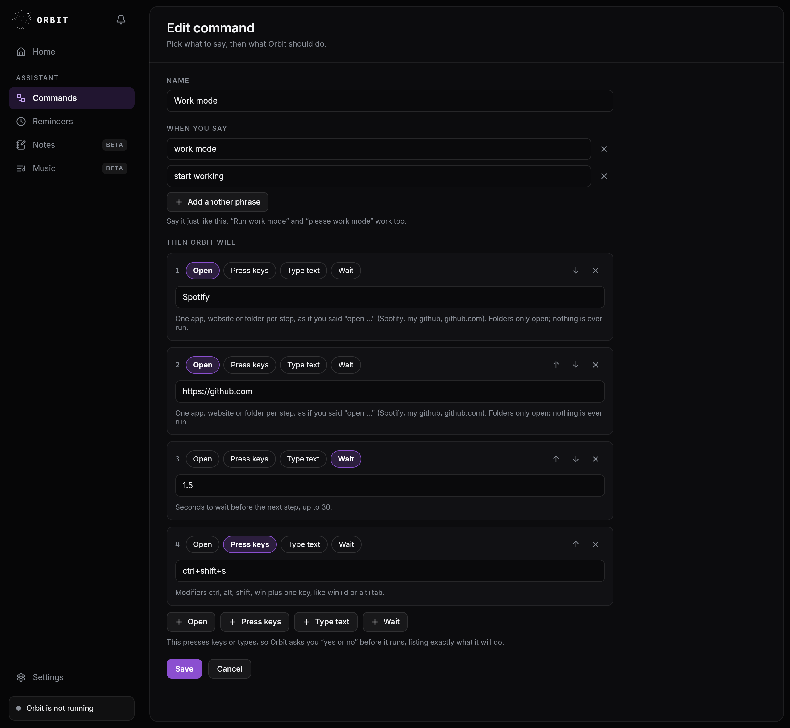<br><sub>The editor: phrases, then steps</sub></td>
  </tr>
</table>

**Sounds.** A soft tone when the orb fades in and another when it fades away, with a switch and a volume slider (0 to 100).
Only a real show or hide makes a sound, and it costs nothing at rest.

<p align="center">
  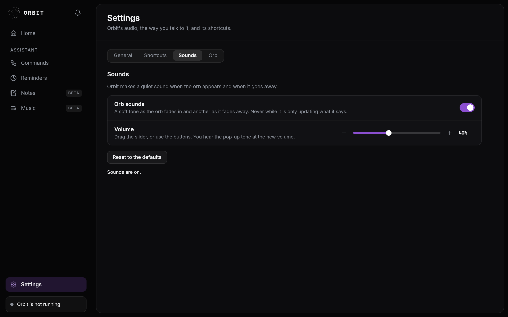
</p>

**Customization.** Put the orb anywhere on your screen: drag it on a small copy of the screen, or press one of nine spots, and
pick Small, Medium or Large. The real orb shows while the page is open so you see where it lands. It stays inside the usable
screen (above the taskbar), and a question's card opens above it, or below it when the orb is in the top half.

## Reminders, notes, tasks and music

Say it, or make it in the window; either way it is the same file, so each shows up on the other at once. They are plain JSON files
next to `settings.json` (`reminders.json`, `notes.json`, `music.json`; git-ignored), written whole or not at all, and read again
whenever the other side changes them. None of this needs the language model.

**Reminders.** "Remind me to call mom at 5pm", "remind me in 10 minutes to stretch", "remind me tomorrow at 9 to submit the form",
"remind me every weekday morning to drink water", "set a timer for ten minutes", "set an alarm for 7 am", "what are my reminders",
"cancel the reminder about mom", "cancel all my reminders" (that one asks yes or no first). When one is due Orbit says it
("Reminder: call mom.") and the window shows it on the bell; one that came due while Orbit was off is still said if it was in the
last six hours. The page has the list (switch off, edit, delete), a form with quick buttons ("In 10 min", "This evening"...) and
repeats (every day, weekdays, week, month), and a list of what went off lately. A time with no am or pm is the next one that comes
round ("at 5" is the afternoon if that is still ahead); an alarm is always the morning.

**Notes and tasks.** "Note down the wifi is on the router", "take a note that I parked on level 3", "what notes do I have", "read my
last note"; "add milk to my tasks", "what's on my to do list", "mark milk as done", "I finished the eggs" (only when that is one of
your tasks: otherwise it is just chat), "clear my completed tasks". On the page: a search box, the Notes and Tasks tabs, a note
editor that saves a moment after you stop typing (Ctrl+K makes a new note), and a checklist.

**Music.** Paste a Spotify link (a playlist, album, artist, track or podcast; `open.spotify.com/...` or a `spotify:` address) on the
Music page and Orbit keeps it by name. It asks Spotify's public page what it is called (nothing about you is sent, and no login is
needed for that), or you can rename it. Then "play my gym playlist" plays it, "what playlists do I have" lists them, and the Play
button on the page asks Orbit to play it (the one other thing the window may send over the link: it names a playlist you saved, and
nothing else). Playing needs the Spotify login like the rest of the Spotify tools. Links from Apple Music, YouTube or Deezer are
refused with the reason.

### Tray, cost and safety of the link

- **Tray menu** (right-click): show or hide the orb, open the Orbit window, Settings, quit (which also stops the Orbit it started).
  Ctrl+Alt+O, or a click on the tray icon, pins the orb on screen. Windows 11 hides new tray icons in the "hidden icons"
  flyout: turn Orbit on in Settings, Personalization, Taskbar, Other system tray icons to keep it in view.
- **Cost at rest:** about 0% of one core and about 100 MB with the orb hidden; about 10% of one core while it animates.
- **Only this PC, only the window.** The link is a WebSocket on `127.0.0.1` (port 8765, `--ipc-port` or `ORBIT_IPC_PORT`) and
  needs a random token that the app hands Orbit itself. A connection from a web page is always refused (a browser always sends
  its page's origin), so no website can listen to your voice turns or answer a question for you. `ORBIT_IPC_ORIGINS` names pages
  you want to allow.
- **A face can send exactly two things:** the yes or no for an open question, and the Play button on a saved playlist (which names
  a playlist from `music.json`; an id that is not in that file plays nothing). It cannot send requests or press keys. Audio never
  leaves Orbit: the face gets one loudness number about 20 times a second, only while a voice is being heard.
- **Clean shutdown.** The app keeps a pipe open to the Orbit it started, so closing or crashing it stops Orbit cleanly: there is
  never an Orbit listening with nobody to show it.
- **Run it by hand:** `python -m orbit --voice --ipc` prints the link to give `orbit-ui --url ...`. Without a microphone,
  `python -m orbit.ipc.demo` (add `--confirm` for the question) plays a scripted turn on the same link.

## Voice

Voice lives in `src/orbit/voice/` (test bench: `python -m orbit.voice.run --help`). Start it with `python -m orbit --voice`.

Start a turn by **holding Right Ctrl** (changeable in Settings: any key, or a mouse button) while you speak, or by saying **"hey orbit"**
(`--no-wake`, or the Wake word switch in Settings, for hold-to-talk only; `--mic "<name>"` picks the microphone). Orbit transcribes what you said, runs the same `agent.handle(text)`
as the text prompt, and speaks a short reply.

- **Short, natural spoken replies.** The agent's terse tool reports are rephrased for speech ("asked 'Spotify Premium' to close"
  is spoken as "Okay, closing Spotify."). When it did not understand, it says what it heard and asks again. One or two
  sentences, never URLs, code or lists; the full reply is always printed. `CONVERSATIONAL = False` in `voice/config.py` reads the
  reports out as they are.
- **No dead air, but no silly fillers.** If the agent takes longer than about 2.5 s *and has not done anything yet*, Orbit says
  "One moment." (and "Still working on it." after about 8 s). Once a click, scroll or move has already happened, it stays quiet
  and just reports what it did ("I clicked the play button."), so you never hear "Let me check." after the work is done.
  `FILLERS = False` turns fillers off. Control names are said like a person would say them (no "(f)" shortcut hints, no emoji,
  long video titles cut at a natural break), and an accidental repeat ("Home page opened. Home page opened.") is said once.
- **Questions get answers.** After Orbit asks you something, it listens for 6 s without the wake word. After any reply you have
  2 s for the next request without the wake word (`--no-follow-up` turns that off).
- **Risky actions ask by voice.** "Do you want me to close window Notepad? Say yes or no." Only a clear yes runs it; silence,
  "maybe" or anything unclear is a no.
- **End the conversation by voice.** After "hey orbit" Orbit keeps listening for a few seconds. Say **"nothing"**, **"leave it"**,
  **"never mind"**, **"let's talk later"**, **"that's all"**, **"no thanks"**, **"not now"**, **"bye"**, **"good night"** or
  **"stop listening"** (also "forget it", "I'm done", "talk to you later", "go to sleep", "be quiet", "end the conversation" and
  more) and Orbit answers with a short goodbye ("Okay, talk to you later.") and goes back to waiting for "hey orbit": no
  follow-up window opens, and the language model never sees it. Only whole sentences count, so "nothing is playing", "do nothing" or
  a bare "stop" (which can mean the music) are not goodbyes. Common Hindi and Tamil phrases ("kuch nahi", "rehne do", "baad mein
  baat karte hain", "onnum illa", "appuram pesalam", and the same in Devanagari and Tamil script) work too, best effort. The same
  phrases end a chat in the text prompt. The phrase list is `src/orbit/voice/farewell.py`.
- **Interrupt it by voice.** Say "hey orbit" while Orbit talks: it mutes the instant the wake word model fires and stops for good
  once a Whisper check agrees. Holding the key also interrupts at once. To avoid hearing itself, Orbit subtracts its own voice
  from the microphone (echo cancellation; earbuds need none). `BARGE_IN = False` switches this off. Run
  `python -m orbit.voice.run echotest` to measure whether it works with your speaker and microphone. Honest limits: it only
  removes sound Orbit *knows* (its own voice), not music or a TV; Bluetooth speakers delay the sound by an unknown amount
  (the filter covers about 0.5 s); some laptop microphones process the sound in a way a linear filter cannot undo. It was
  verified in simulation, not on the author's own speakers.
- **Not fooled by background sound.** The no-wake follow-up stays closed while music or a video is playing, filler "transcripts"
  ("Uh...") and Whisper's silence hallucinations ("Thank you.") are ignored, and a raw tool call is never read out loud.
- **Faster.** The language model is loaded when voice starts and kept loaded (Ollama otherwise unloads it after a few minutes and
  the next request waits about 20 s); transcription starts at a 0.55 s pause and is kept only if you really stopped.
- **Kill switch:** Ctrl+Alt+Esc stops the microphone instantly; Orbit carries on in text mode. If voice cannot start (no
  microphone, a missing model) it says why and falls back to the text prompt instead of crashing.
- **Where the time goes** (printed after each turn): on the author's PC, about 3.2 s from the end of speech to the first spoken
  word with local models (speech-to-text about 2.0 s dominates), about 2.8 s with hold-to-talk. A busy PC is slower. Cloud mode
  is the way to bring this down.

Dev bench without a microphone or a real agent: `python -m orbit.voice.loop --echo-agent --wav replay.wav` (a stand-in agent that
repeats your request; "close notepad" pretends to be risky so you can try the spoken yes / no).

### Cloud mode: Groq + Sarvam AI

Groq runs the language model; Sarvam does speech-to-text and the voice. Both are optional and independent.

1. Get keys: Groq at <https://console.groq.com/keys>, Sarvam at <https://dashboard.sarvam.ai>.
2. Copy `.env.example` to `.env` and paste them in (`.env` is git-ignored; a variable set in your terminal overrides the file):
   ```
   GROQ_API_KEY=gsk_...
   SARVAM_API_KEY=...
   ```
3. Check them: `python -m orbit.cloud_check` (one tiny request each, prints the seconds each took).
4. Run as usual. Each part switches to the cloud when its key exists (`ORBIT_LLM`, `ORBIT_STT`, `ORBIT_TTS` = `auto` | the cloud
   name | the local engine; `--llm ollama` forces the local model for one run). `ORBIT_LANGUAGE` picks the language you speak
   (`en-IN`, `hi-IN`, ...); the other settings are listed in `.env.example`.

Only the speech clip trimmed by the local silence detector is uploaded (never the always-on microphone stream); the wake word
and echo cancellation stay local, and Orbit saves no audio. If the internet or a service fails, Orbit falls back to Whisper /
Piper / Windows voice for the next minute instead of waiting on timeouts; the language model has no automatic fallback (use
`--llm ollama`).

### Wake word: "Hey Orbit"

openWakeWord ships no "Orbit" model, so `hey_orbit` is trained here, offline, in about 6 minutes:
`python -m orbit.voice.run train-wake` (needs the feature models: `fetch_models wakeword hey_mycroft`). The result is
`models/openwakeword/hey_orbit.npz` (not committed).

- **Train it on your own voice** for much better results: `python -m orbit.voice.run record-wake --device "Microphone Array"
  --count 25 --talk 60`, then `train-wake` again. These clips stay local (git-ignored).
- **Every candidate is double-checked** by a quick local Whisper pass (`tiny.en`) that must hear "orbit", so look-alikes are
  rejected. The wake-word classifier runs all the time at under 1% CPU; the check runs only on candidates.
- **Honest numbers (synthetic voices only):** on Windows David and Zira at three speeds, which were not used for training, 22 of
  24 "hey orbit" clips woke it and 0 of 84 other clips did. Real rooms, TV and your voice are a different test: measure false
  wakes yourself with `python -m orbit.voice.run wake`.
- Pre-trained stand-ins still work: `--word hey_mycroft` (or `alexa`, `hey_jarvis`).

## Friend mode

Orbit is also a friend you can talk to, not just a PC remote. Tell it about your day and it reacts and encourages you; ask for a
roast; ask a doubt ("what's the difference between a process and a thread?") and it explains in plain words with an example; say
you are stressed or low and it slows down and is kind. It remembers the last 8 exchanges (in memory only; `clear` forgets them).

- **Chat or command.** PC commands ("open spotify", "volume 30", "what's playing?") go through the rules and tools exactly as
  before. Anything else is chat, answered by a friend persona with no tools. Obvious cases are decided by simple word checks;
  only unclear ones cost one tiny extra model call. Turn it off with `--no-friend` or `ORBIT_FRIEND=0`.
- **Emotion.** Every chat reply starts with a hidden feeling tag (neutral, happy, excited, proud, caring, sad, teasing, calm,
  serious) that sets the voice's speed and expressiveness. Honest limit: Sarvam's voice only lets us change pace and how varied
  the delivery is, so most of the feeling comes from the words. Offline, Piper only changes speed.
- **Spoken whole.** Chat replies are spoken in full (up to 5 sentences), and the conversation stays open for 8 s after a reply.
- **Safety.** Roasts are playful and only about what you did (procrastination, snacks, sleep), never looks, family, religion,
  money or health. If you sound low it skips the jokes. If you say something that sounds like hurting yourself it drops the
  humour, answers seriously and encourages you to reach out to someone you trust or a local helpline. It is an AI model, not a
  therapist, and it cannot browse the internet, so double-check facts that matter.
- **Settings (`.env`).** `ORBIT_USER_NAME`, `ORBIT_FRIEND`, `ORBIT_GROQ_FALLBACK_MODEL` (answers when the big model hits the
  free-tier token limit).

## Ask about your screen

Point at something with the mouse and ask: **"what does this mean?"**, **"what is this error?"**, **"what's going on in this
screen?"**, **"explain this"**, **"summarize this page"**, **"translate this"**, **"I have a doubt about this"**, **"is this
safe?"**, **"what am I looking at?"**. Orbit reads the window your mouse pointer is on and answers from what it finds, in plain
words (spoken whole, like a chat reply), and you can keep asking follow-ups.

What it reads, and what it cannot:
- **It reads text, it cannot see pictures.** It gets the window's title and program; the control under the pointer as Windows names
  it ("button Backspace", "data item ..., inside table Folders and files"); any text you have **selected** (the best way to say
  exactly what you mean: select a word or line, then ask "what does this mean?"); the words around the pointer and the word
  it is on, read with OCR; and, in a browser, the page's own visible text. A photo, a video frame, a chart or a game gives it
  little, and it says so instead of guessing.
- **Selecting text is the most reliable pointer.** With nothing selected it uses the words nearest the mouse pointer.
- It takes about 0.3 s to read an ordinary window and about 2 s for a browser page, plus the model's answer.
- **When Orbit's own terminal is under the pointer** (text mode), it looks at the window behind it instead and says so.
- Only **your own question** triggers it. The language model is never offered the screen reader and cannot call it, so a web page
  or a document cannot trick Orbit into reading your screen.

Privacy: the text it reads goes to the language model for that one question. With the **local** model (Ollama) it never leaves
this PC; with the **cloud** model (Groq) it is sent to Groq, and Orbit prints that when it happens (`[screen] ... sending that text
to Groq ...`). Before it is sent, things that look like passwords, API keys, tokens and card numbers are masked. It reads
nothing until you ask. Turn it off with `ORBIT_SCREEN_HELP=0`.

## Spotify (API layer)

The router prefers the API layer over OS and browser. Login uses PKCE, so there is no client secret anywhere; the refresh token
lives in the Windows Credential Manager (`Orbit/spotify-refresh-token`), never in a file or the logs. Spotify tools only appear
when `SPOTIFY_CLIENT_ID` is set.

- **Play** a song, artist, album, playlist, or "my favourite music" (your liked songs). **Transfer** playback to a device by
  name, optionally with a volume ("this" = the Spotify app on this PC). "speaker", "phone" and "tv" work as device kinds and
  are never guessed when there are two of a kind. **Control** play, pause, next, previous on whichever device is playing, list
  devices, now playing.
- **Volume follows the sound.** When Spotify plays on a speaker or phone, "reduce the volume", "make it louder" and "volume 40"
  change THAT device (relative or absolute); when it plays on this PC or something else is playing, they change the PC volume.
  Name a device to be explicit ("echo pop volume 50", "set the volume of the speaker to 30").
- **Your saved playlists** (the Music page) play by name ("play my gym playlist") through their own tool, which only Orbit's code can
  run (the language model is never offered it): it plays exactly the address you saved, never a search.
- **Pause, play, next, previous** go through Spotify itself whenever it is the current media player (a speaker cannot be reached
  by the PC media keys); if a media key does nothing and Spotify is involved, Orbit asks Spotify directly. Right after a Spotify
  request, "switch to echo" also means Spotify.

## Browser layer

Two ways to use a browser, chosen with `--browser-mode` (or `ORBIT_BROWSER_MODE`):

- **`mine` (default): your own Brave window and profile.** "open my github", "open youtube" and "search cats" open the link in
  your **Personal** profile (change with `ORBIT_BRAVE_PROFILE`), where you are already logged in. Orbit can then **read and click
  inside that page**: "click the ishowspeed live", "what page am I on", "play some video", "fullscreen". This uses Windows UI
  Automation (what screen readers use), not remote debugging, which Chromium blocks for a profile in use and which sites that
  distrust automation (Google sign-in) do not object to.
  - **Navigation:** "go back", "go forward", "reload", "go to the home page" press the browser's own buttons or load the
    address in the **current tab** ("open ..." opens a new tab). "go back" means the browser, not the previous song.
  - **Tabs:** "list my tabs", "close this tab", "close all other youtube tabs", "switch to the github tab". Closing keeps the tab
    you are on, asks first when 4 or more tabs would close, and refuses to close every tab (that is the window: say "close
    brave").
  - **Search Google and work the results:** "search rune open source project on google" opens the Google results (checked against
    the new page, so Google's consent or robot check is reported instead of claimed as results). Then "scroll down", "scroll
    up a little", "scroll down 3 times", "scroll to the bottom", "page down" turn the mouse wheel over the page (Orbit's pointer
    glides there first; the page must visibly move, otherwise it says it did not). "click the first result", "open the third
    link", "click the last result" pick a hit by number, leaving out the search engine's own menu links and repeats.
  - **Click by picture:** "click the search icon", "the magnifying glass", "the three dots", "the hamburger menu", "the gear",
    "the x button", "the heart", "the plus sign" and about thirty more are looked up under the names pages give those icons
    (the search icon is the button called Search or Google Search, the three dots are "More options", the x is "Clear" or
    "Close"). If the page names nothing like it, Orbit reads the page's pixels with OCR and clicks where it finds the words (even
    words drawn inside an image) or a symbol character such as x, +, a heart or a play triangle.
  - **Click a box, type, press Enter:** "click the search box and type tamil news live", then "press enter" (or "type cats and
    press enter", or "search for cats in the search box"). Clicking a box puts the cursor in it; typing goes into the box that has
    the cursor and is read back to check it; on a search box that already holds words, the new words replace them. Orbit never
    types into a password field, never types when no text box has the cursor (it would only trigger the page's keyboard
    shortcuts), and only types words **you** said: text found on a page or screen is never typed, even if the language model
    were tricked into asking.
  - **Typo-tolerant clicks:** "clcik theh traver walles viedo" finds "Trevor Wallace Making ...", but Orbit never invents a
    match: if nothing on the page is close, it says so and lists what it can see.
  - **Limits:** it sees links, buttons and fields by their names (plus the OCR fallback above); it works on the Brave window in
    front; a click is confirmed by the page, address or the control's own label changing, so a click with no visible effect
    is reported as failed; clicking something risky-looking (buy, send, delete, pay...) asks you first, and Orbit refuses to press
    a risky-looking control you did not name.
- **`orbit`: Orbit's own automated window** (also used for "play X on youtube" + fullscreen, which Orbit verifies from the video
  element). It has a separate profile in `.browser-profile/` and never touches your everyday profiles. Sites that distrust
  automated browsers refuse sign-in there (Google shows "Couldn't sign you in"); GitHub's own login works. Switch the browser
  with `--browser chrome`.

"open my github" opens `github.com/lennydany3` (change with `ORBIT_GITHUB_USER`); "open github" opens the site. Only http(s)
links are opened. Web search uses Google.

## Privacy

- **Local by default.** Microphone capture, wake word, voice-activity detection, echo cancellation and hotkeys always run on this
  PC. With no API keys, nothing leaves the PC. With keys, the speech clip, the reply text and your requests go to Sarvam and
  Groq; Orbit prints which mode it is in when voice starts.
- **The screen is read only when you ask about it** ("what does this mean?"), and then only the window under your mouse pointer, as
  text. It goes to the language model for that answer (to Groq in cloud mode; nowhere in local mode), with passwords, keys, tokens
  and card numbers masked first. See [Ask about your screen](#ask-about-your-screen).
- **Nothing is recorded while idle.** Audio is only kept in memory for the turn being processed and is never saved. The only
  recordings are the test clips you make yourself with `record` / `record-wake` (git-ignored).
- **Logs** go to `logs/` (git-ignored). Every state change is logged with a timestamp; what you said is only written if
  `LOG_TRANSCRIPTS = True` in `voice/config.py`.
- **Nothing is downloaded behind your back.** `fetch_models` is the only voice code that uses the network, and only when you run
  it. `.env`, `settings.json`, `reminders.json`, `notes.json`, `music.json`, `models/` and `.browser-profile/` are git-ignored.

## Project layout

```
src/orbit/
  agent/          rules, router, safety gate, friend mode, screen questions, rescue, custom commands, reminders/notes/playlists by voice, the loop
  tools/
    api_layer/    Spotify (PKCE login, Credential Manager)
    os_layer/     apps, windows, monitors, volume, media keys, UI Automation + OCR clicks, processes
    browser_layer/ your Brave profile (UI Automation) and Orbit's own automated window (Playwright)
  llm/            Ollama (local) and Groq (cloud)
  voice/          microphone, wake word, VAD, echo cancellation, speech-to-text, voice, the voice loop, ending a conversation
  ipc/            the WebSocket link to the desktop app
  reminders.py, notes.py, playlists.py, userdata.py   the files the window and Orbit share, and understanding "remind me ... at 5"
  visual/         the on-screen animations: Orbit's pointer, the click ripple, the working pill
ui/               orbit-ui: the tray app and sphere (Rust + Rune)
tests/            1719 Python tests, plus shared fixtures the Rust side is tested against
docs/screenshots/ the pictures in this file
```

The screenshots are real renders of the window, made headless with
`cargo run -- --snap out.png --size 1280x800 --scene <name>` from `ui/` (scenes are listed in `ui/src/main.rs`).

## Known limits (honest list)

**Spotify**
- A phone or speaker only shows up as a Spotify device while its Spotify app is open or was used recently (Echo speakers can be
  slow to wake and sometimes need a second try). Spotify's own "transfer" call sometimes answers HTTP 500 for this PC; Orbit then
  restarts the current song on the target device and says so.
- Premium is needed for play and transfer. In development mode only accounts listed under User Management (max 5) can log in.
- Spotify must be running on the PC for it to appear as a device; a multi-step request opens it first. Its volume is separate
  from Windows volume.
- Playlist playback can only be confirmed as "something is playing", not that it came from that playlist. "Favourite music" is
  your liked songs (the 50 most recent). Spotify's API sometimes does not report what context is playing, so artist and album
  playback is verified from the current track.

**Browser**
- YouTube "playing" is verified from the video element, so a pre-roll ad counts as playing. Cookie-consent pages (EU) must be
  accepted once by hand.
- A browser click cannot be retried automatically (a second click could undo the first); if nothing visibly changes it reports
  failure.
- Pages that block automation (captchas, logins with 2FA) cannot be driven in Orbit's own window.

**Windows**
- Media keys go to whatever Windows treats as the current media session (often the last app that played). `pause` and `play` are
  safe to repeat; `next` and `previous` are verified by track change, which cannot be confirmed for live streams or one-track
  playlists.
- Opening an app finds it by Start-menu name; if two apps match ("visual studio") it asks instead of guessing. Store apps can
  show their window under a generic host, so window matching may miss some.
- Windows may refuse to bring a window to the front; the tool then reports failure rather than pretending.
- "Works on every app" is not achievable. Games and custom-drawn UIs may not be controllable.
- **Administrator windows (Task Manager, anything started "as administrator") cannot be controlled by a normal program.**
  Windows refuses to let Orbit close, minimize or move them, and Orbit says so up front. To control such windows, start Orbit
  from a terminal opened with "Run as administrator"; that gives Orbit (and anything it runs) full administrator rights, so only
  do it when you need it.
- **Closing a window is not quitting the app.** Many apps (ChatGPT, Spotify, Discord ...) keep running in the tray after the
  window closes. "close chatgpt" closes the window and tells you it is still running; **"quit chatgpt"** (also "exit", "kill",
  "force close", "close chatgpt completely") ends all of the app's processes. It always asks first, because quitting can lose
  unsaved work. It never quits Windows itself, system services, the Ollama model server, or the program Orbit runs inside.
- "Close" asks the window to close like its X button (nothing is force-killed). If the app shows a "save changes?" box the window
  stays open and Orbit reports that. A window whose title looks unsaved (starts with `*`) asks you first. Orbit never closes its
  own terminal.

**Language model and memory**
- The local 7B model makes mistakes on vague or multi-step requests; expect 10-20 s for those (it once read "quieter, around 20
  percent" as 67%). Simple commands skip the model, and the cloud model is faster and more accurate.
- Memory is short-term: the model sees your last 6 requests (capped at about 5,000 characters) so "close it" works. It is
  forgotten when you quit; type `clear` to forget sooner.
- Ctrl+C during a model call takes effect when that call returns (at most the 120 s timeout).

**Screen questions and ending a conversation**
- Orbit answers from **text** (OCR, Windows' accessibility names, a browser's page text), never from pictures. OCR can misread small
  or stylised text, and apps that publish no accessibility information (many Electron apps) rely on OCR alone. If the text does not
  say, Orbit says so; it is a language model, so double-check an answer that matters (an error's fix, a safety judgement).
- "This" means the window under the mouse pointer (selected text if there is any). If your pointer is somewhere else, say what
  you mean, or point first and ask again.
- A sentence about music or the clock ("what is this song") is never treated as a screen question; if a screen question is
  missed, add the word "screen" ("what does this mean on my screen").
- A goodbye must be a whole sentence ("nothing", "leave it"), so a bare "stop" is left alone (it can mean the music), and a
  mis-heard goodbye just means Orbit waits for "hey orbit" again. The Hindi and Tamil phrase lists are best effort.

**Animations, typing and scrolling**
- Orbit's pointer and the "working" pill are drawn on top of the screen and are hidden from screen capture only on Windows 10
  2004 and newer. They are a picture of what Orbit does: the action itself is still done the accessible way (or with a real click
  or wheel turn when it must be), and verified from what changed on screen.
- A symbol (an icon with no words) is found by the name the app gives it, or by OCR when it is a character OCR can read. A
  drawn icon that has no name and is not a character (a custom logo, a bare arrow) cannot be found: Orbit says so instead of guessing.
- Scrolling turns the real mouse wheel over the page, so the mouse pointer jumps there for a moment and back. A page that is
  shorter than the window cannot scroll and is reported as "did not move".
- Typing is only for a box that has the cursor, and replaces the old words only in search-like boxes (so it cannot wipe a
  document). A box that cannot be read back (a custom-drawn app) is checked by the window visibly changing instead.
- Google may show a consent page or a robot check instead of results (more often in Orbit's own automated window than in your own
  Brave); Orbit reports it rather than saying it searched.

**Desktop app**
- The floating orb is a separate overlay window, so the screenshots above show the main window only.
- The `.exe`'s own icon in Explorer is not set (that needs a Windows resource file at build time); the window, taskbar and
  tray icons are.
